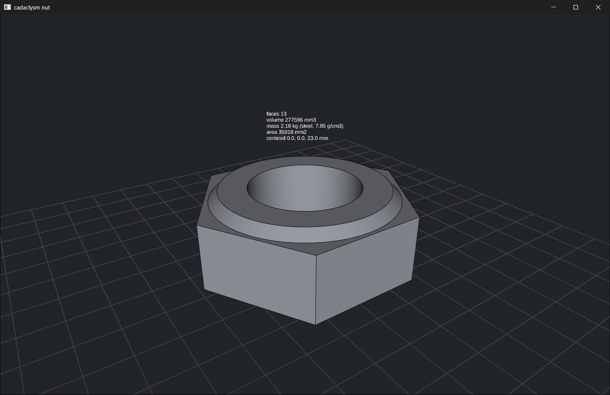
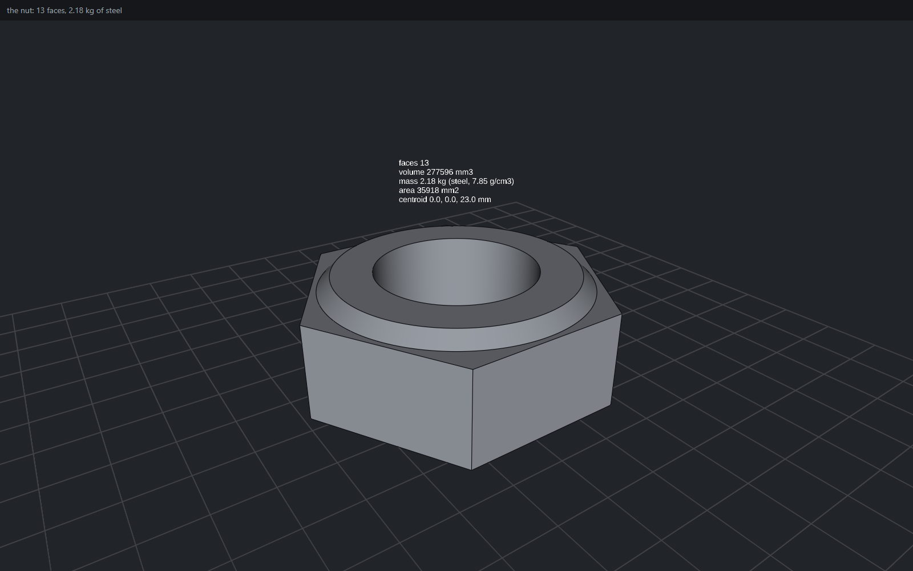

# cadaclysm nut example

A hex nut modelled in Rust with [cadaclysm](https://cadaclysm.blitter.studio), then
shown in two places from the same code: a desktop window and a web page, each with the
nut's figures (volume, mass in steel, area, centroid) drawn beside it.

| On the desktop | In the browser |
|---|---|
|  |  |

The nut is an exact B-rep solid, not a mesh: a hexagon prism intersected with a turned
ring, giving 13 faces. You can save it as STEP and open it in any CAD program.

This README walks through the example one step at a time. The code is short:
[`src/lib.rs`](src/lib.rs) builds the nut and shows it, [`src/main.rs`](src/main.rs) is the desktop
program and [`src/web.rs`](src/web.rs) is the browser one.

## What you need

- Rust (stable), from [rustup](https://rustup.rs).
- For the desktop: nothing else. When the `cadaclysm-sdk` crate builds, it downloads the
  cadaclysm libraries for your platform (Windows x64, macOS 11+, Linux x64 and arm64).
- For the browser:
  - the wasm target: `rustup target add wasm32-unknown-unknown`
  - `wasm-bindgen-cli`, at the same version as the `wasm-bindgen` in `Cargo.lock`
    (0.2.130 here): `cargo install wasm-bindgen-cli --version 0.2.130`
  - the cadaclysm web package, `cadaclysm-0.14.0-web-pro.zip`, from the
    [SDK's releases](https://github.com/rdeioris/cadaclysm-sdk/releases/tag/v0.14.0)
  - any static web server. The steps below use Python's.

## Step 1: the crate

[`Cargo.toml`](Cargo.toml) describes one crate that builds two programs:

```toml
[lib]
crate-type = ["cdylib", "rlib"]

[[bin]]
name = "desktop"
path = "src/main.rs"

[dependencies]
cadaclysm-sdk = "0.14.1"

[target.'cfg(target_arch = "wasm32")'.dependencies]
wasm-bindgen = "0.2.100"
wasm-bindgen-futures = "0.4.50"
web-sys = { version = "0.3.77", features = ["Document", "Element", "HtmlCanvasElement", "Window"] }
```

- The library holds the nut. The desktop program links it as an `rlib`. The browser
  loads it as a `cdylib`, a `.wasm` file.
- `cadaclysm-sdk` is the only dependency on the desktop.
- The three wasm crates are needed only when building for the browser.

## Step 2: model the nut

[`src/lib.rs`](src/lib.rs) builds the nut in three moves:

```rust
use cadaclysm_sdk::blacksmith::{Frame, Profile, Solid};

pub fn nut() -> cadaclysm_sdk::Result<Solid> {
    // A hexagon 60 mm from the centre to each corner, extruded 46 mm up from the XY plane.
    let hexagon = Profile::regular_polygon([0.0, 0.0], 60.0, 6, 0.0)?;
    let prism = Solid::extrude(&hexagon, &Frame::xy([0.0; 3]), 46.0)?;

    // Half the section of a ring, drawn in the XZ plane (x is the radius, y the height),
    // turned a full circle about the Z axis.
    let section = Profile::polygon(&[
        [30.0, 0.0], [45.0, 0.0], [50.0, 5.0], [70.0, 5.0],
        [70.0, 41.0], [50.0, 41.0], [45.0, 46.0], [30.0, 46.0],
    ])?;
    let ring = Solid::revolve_in_plane(&section, &Frame::xz([0.0; 3]), [0.0, 0.0], [0.0, 1.0], std::f64::consts::TAU)?;

    // What the two share is the nut. 0.05 mm is the tolerance the boolean works at.
    prism.common(&ring, 0.05)
}
```

1. **The prism.** `Profile::regular_polygon` draws a flat hexagon, and `Solid::extrude`
   pushes it 46 mm up along the frame's Z axis.
2. **The ring.** The section is half of a ring's cross-section: its inner edge at radius
   30 mm is the hole, and its sloped corners at the top and bottom become the chamfers.
   `Solid::revolve_in_plane` turns it a full circle about the Z axis.
3. **The nut.** `common` keeps only the volume that the prism and the ring share: the
   ring bores the hole and chamfers both faces, and the prism keeps its six flat sides.

Every call returns a `Result`. A bad input, such as a polygon with two sides, comes back
as an error with the kernel's own explanation.

## Step 3: show it, with its figures

Also in [`src/lib.rs`](src/lib.rs), `present` draws the nut in a `View` and writes its
figures above it. Both programs call it, so the desktop window and the web page show the
same thing:

```rust
use cadaclysm_sdk::view::{Align, Text, View};

/// Steel, in kg per mm³ (7.85 g/cm³). The kernel measures the volume; the material is ours.
const STEEL: f64 = 7.85e-6;

pub fn present<'a>(view: &View<'a>, nut: &'a Solid) -> cadaclysm_sdk::Result<String> {
    let mass = nut.mass(0.0)?;
    let faces = nut.faces()?;
    let kg = mass.volume * STEEL;
    let [cx, cy, cz] = mass.centroid;
    let figures = format!(
        "faces {faces}\nvolume {:.0} mm3\nmass {kg:.2} kg (steel, 7.85 g/cm3)\narea {:.0} mm2\ncentroid {cx:.1}, {cy:.1}, {cz:.1} mm",
        mass.volume, mass.area
    );

    view.show_solid(nut, 0.05, None)?;
    // 70 mm up: 24 mm above the nut's top face, so the label clears its far rim.
    view.show_text(&Text::label(figures, [cx as f32, cy as f32, 70.0]).size(16.0).colour("white").align(Align::Bottom))?;
    view.frame()?;
    Ok(format!("the nut: {faces} faces, {kg:.2} kg of steel"))
}
```

- **`nut.mass(0.0)`** measures the solid exactly: its volume, surface area and centroid.
  The kernel doesn't know what the nut is made of, so the density, steel here, is ours.
- **`show_solid`** hands the exact solid to the view, which meshes it itself.
- **`Text::label`** puts text at a point in the model, so it moves with the nut when you
  orbit. `Align::Bottom` puts the text above that point.
- **`frame`** fits the camera to what the view shows.
- The returned line is a short summary for the program to print or display.

The `'a` lifetime says the view borrows the nut: the nut must live as long as the view
that shows it.

## Step 4: show it on the desktop

[`src/main.rs`](src/main.rs) builds the nut, saves a STEP file and opens a window:

```rust
use cadaclysm_sdk::blacksmith::Unit;
use cadaclysm_sdk::view::{self, View, ViewOptions};

fn main() -> cadaclysm_sdk::Result<()> {
    let nut = nut::nut()?;

    nut.step("nut.step", None, Unit::Millimetre)?;
    println!("saved nut.step");

    // A window of its own: drag to orbit, wheel to zoom.
    view::use_wgpu()?;
    let view = View::new(&ViewOptions { title: Some("cadaclysm nut".into()), ..ViewOptions::default() })?;
    println!("{}", nut::present(&view, &nut)?);
    view.run()?; // returns when the window is closed
    Ok(())
}
```

Run it:

```sh
cargo run --release
```

The first build takes a minute because it downloads the libraries. Then:

```text
cadaclysm: unlicensed -- running without a production license; licenses at https://cadaclysm.blitter.studio/license
saved nut.step
the nut: 13 faces, 2.18 kg of steel
```

The window opens with the nut framed and its figures above it. Drag to orbit and use the
wheel to zoom. The program ends when you close the window.


- **`view::use_wgpu()`** picks the windowed view. Without it, the view draws into your
  terminal (sixel, kitty graphics or coloured blocks), which also works over SSH.
- **`view.run()`** keeps the window open and returns when it is closed.
- **The notice** is normal: without a licence the libraries run in full and say so.
  See [The licence](#the-licence) below.

## Step 5: the browser program

A browser can't load native libraries. On `wasm32`, `cadaclysm-sdk` instead calls the
cadaclysm web package, a wasm module that runs in the same page. The modelling code and
`present` don't change: they run as they are.

The kernel blocks the thread it runs on, so it shouldn't run on the page's own thread or
the page would freeze. [`src/web.rs`](src/web.rs) has two halves: one on the page and one
in a Web Worker.

**On the page**, `page_main` starts the worker and asks it about the nut:

```rust
#[wasm_bindgen]
pub fn page_main() -> Result<(), JsValue> {
    // ... find the <canvas id="nut"> ...
    let worker = page::spawn(&canvas, App { glue: "./app/nut.js", entry: "worker_main", package: "./pkg/index.js" })?;
    worker.on_message(move |data| { /* show the worker's reply in the status line */ });
    worker.post(&JsValue::from_str("figures?"))?;
    Ok(())
}
```

`page::spawn` does the setup a worker needs:

- sizes the canvas to its on-screen size in device pixels;
- starts a worker that runs this same wasm, beginning at `worker_main`;
- hands the canvas over to the worker;
- forwards drag, wheel, pinch and resize events to it.

The `"figures?"` message is posted at once, while the worker is still loading. It is
kept and delivered once the worker is ready for it.

**In the worker**, `worker_main` loads the package, builds the nut and shows it on the
canvas with the same `present` as the desktop:

```rust
#[wasm_bindgen]
pub async fn worker_main() -> Result<(), JsValue> {
    let worker = worker::start(LoadOptions::new("./pkg/index.js")).await?;
    let nut = crate::nut()?;
    let view = View::on_canvas(worker.canvas(), &ViewOptions::default()).await?;
    let summary = crate::present(&view, &nut).unwrap_or_else(|e| e.to_string());

    let reply = worker.clone();
    worker.on_message(move |data| {
        if data.as_string().as_deref() == Some("figures?") {
            let _ = reply.post(&JsValue::from_str(&summary));
        }
    });
    view.run().await?;
    Ok(())
}
```

- **`View::on_canvas`** makes the view on the worker's canvas. It is the browser's
  `View::new`: the same `View`, with the same methods.
- **`view.run().await`** is the browser's `run`. It delivers the messages and controls
  that waited while the worker loaded, then keeps the view, and the nut, alive while the
  page is open.

**The page**, [`web/index.html`](web/index.html), is a canvas, a status line and four
lines of script:

```html
<div id="status">loading…</div>
<canvas id="nut"></canvas>
<script type="module">
import init, { page_main } from "./app/nut.js";
await init();
page_main();
</script>
```

`page_main` is called from the page rather than marked `#[wasm_bindgen(start)]`. The
worker runs the same wasm, and a start function would run there too.

## Step 6: build and run in the browser

1. Build the library for wasm. `--lib` leaves out the desktop program:

   ```sh
   cargo build --lib --release --target wasm32-unknown-unknown
   ```

   Nothing is downloaded this time. The browser build uses the web package instead of
   the native libraries.

2. Generate the JavaScript glue into `web/app`:

   ```sh
   wasm-bindgen --target web --out-dir web/app target/wasm32-unknown-unknown/release/nut.wasm
   ```

3. Unzip `cadaclysm-0.14.0-web-pro.zip` and copy its `pkg` folder to `web/pkg`. The
   folder should now hold:

   ```text
   web/
     index.html
     app/   nut.js, nut_bg.wasm, snippets/   (from wasm-bindgen)
     pkg/   index.js, view.js, cadaclysm_bg.wasm, ...   (from the zip)
   ```

4. Serve the folder and open it:

   ```sh
   python -m http.server 8000 --directory web
   ```

   Then go to <http://localhost:8000>. The page must come from a server: browsers don't
   run wasm modules or workers from `file://`.

The status line says "loading…", then "the nut: 13 faces, 2.18 kg of steel", and the nut
appears with its figures, as on the desktop. Drag to orbit, use the wheel or a pinch
to zoom.


Your app's own wasm is about 600 KB (140 KB gzipped). Most of the download
is the web package's wasm, about 5.5 MB gzipped.

**If the page stays on "loading…"**, open the browser's console:

- *"Failed to load module script ... MIME type"*: the server sent `.js` as plain text.
  On Windows, Python's server takes its types from the registry. Use another static
  server, or fix the `.js` entry under `HKEY_CLASSES_ROOT\.js` to `text/javascript`.
- *A wasm-bindgen schema version error*: the `wasm-bindgen` CLI doesn't match the
  version in `Cargo.lock`. Install the matching one.

## The licence

Development, testing and evaluation are free. Without a licence everything runs in full
and prints a notice on each open and export. A product, server or website licence
([cadaclysm.blitter.studio/license](https://cadaclysm.blitter.studio/license)) removes it.

- **Desktop:** put `cadaclysm.lic` beside the executable, or set `CADACLYSM_LICENSE`.
- **Browser:** pass it when loading the package, as its text or a URL to fetch it from:

  ```rust
  worker::start(LoadOptions::new("./pkg/index.js").licence("./cadaclysm.lic")).await?;
  ```

## Going further

- The `blacksmith` module has the rest of the modelling kernel: fillets, shells, sweeps,
  lofts, NURBS curves and surfaces, measurements, and STEP and 3DM output. See the
  [Rust documentation](https://cadaclysm.blitter.studio/docs/rust.html).
- In the browser, `Solid::step_text` gives the STEP file as a string to offer as a download.
  Calls that write a file directly refuse, because a page has no file system.
- In the browser, reading CAD files and healing aren't in the Rust crate yet; they work on
  the desktop.

The example uses `cadaclysm-sdk` 0.14.1 with the 0.14.0 web package.
