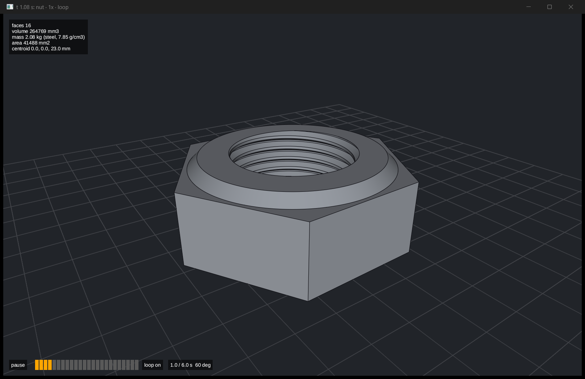
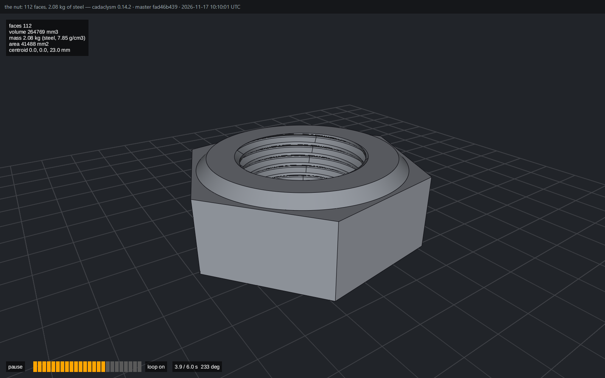

# cadaclysm nut example

A hex nut modelled in Rust with [cadaclysm](https://cadaclysm.blitter.studio), then
shown in two places from the same code: a desktop window and a web page, each with the
nut's figures (volume, mass in steel, area, centroid) in the window's corner. Click a face
and it turns orange, with what it is (its surface, area, centre and normal) in the other
corner. The nut turns on a turntable, with play, pause, seek and loop controls along the
bottom.

| On the desktop | In the browser |
|---|---|
|  |  |

**[Try it in your browser](https://cadaclysm.blitter.studio/nut/)**: this repository's `main`,
built on the cadaclysm site against cadaclysm's latest code, as the
[forge](https://cadaclysm.blitter.studio/forge/) is.

> **`main` builds with the released `cadaclysm-sdk` 0.16.0**, face clicking and the turntable
> included: the thread is cut exactly, so the nut has 16 faces and is built in a few seconds.
> The [`sdk-0.15.0`](https://github.com/rdeioris/cadaclysm-nut-example/tree/sdk-0.15.0) tag
> builds the same program with 0.15.0, whose slower thread leaves 112 faces after about two
> minutes; the [`sdk-0.14.2`](https://github.com/rdeioris/cadaclysm-nut-example/tree/sdk-0.14.2)
> tag is the same nut for 0.14.2, without the clicking and the turntable.

The nut is an exact B-rep solid, not a mesh: a hexagon prism intersected with a turned
ring, with a real screw thread cut into its bore, giving 16 faces. You can save it as STEP
and open it in any CAD program.

This README walks through the example one step at a time. The code is short:
[`src/lib.rs`](src/lib.rs) builds the nut and shows it, [`src/main.rs`](src/main.rs) is the desktop
program and [`src/web.rs`](src/web.rs) is the browser one.

## What you need

- Rust (stable), from [rustup](https://rustup.rs).
- For the desktop: nothing else. When the `cadaclysm-sdk` crate builds, it downloads the
  cadaclysm libraries for your platform (Windows x64, macOS 11+, Linux x64 and arm64).
- For the browser:
  - the wasm target: `rustup target add wasm32-unknown-unknown`
  - `wasm-bindgen-cli`, at the same version as the `wasm-bindgen` in `Cargo.lock`
    (0.2.130 here): `cargo install wasm-bindgen-cli --version 0.2.130`
  - the cadaclysm web package, `cadaclysm-0.16.0-web.zip`, from the
    [SDK's releases](https://github.com/rdeioris/cadaclysm-sdk/releases/tag/v0.16.0)
  - any static web server. The steps below use Python's.

## Step 1: the crate

[`Cargo.toml`](Cargo.toml) describes one crate that builds two programs:

```toml
[lib]
crate-type = ["cdylib", "rlib"]

[[bin]]
name = "desktop"
path = "src/main.rs"

[dependencies]
cadaclysm-sdk = "0.16.0"

[target.'cfg(target_arch = "wasm32")'.dependencies]
wasm-bindgen = "0.2.100"
js-sys = "0.3.77"
wasm-bindgen-futures = "0.4.50"
web-sys = { version = "0.3.77", features = ["console", "Document", "Element", "HtmlCanvasElement", "Window", "WorkerGlobalScope"] }
```

- The library holds the nut. The desktop program links it as an `rlib`. The browser
  loads it as a `cdylib`, a `.wasm` file.
- `cadaclysm-sdk` is the only dependency on the desktop.
- The four wasm crates are needed only when building for the browser.

## Step 2: model the nut

[`src/lib.rs`](src/lib.rs) builds the nut in four moves, in two functions: `blank` makes
the nut without its thread, quickly, and `threaded` cuts the thread into it. The browser
shows the blank while the thread is cut (step 5).

```rust
use cadaclysm_sdk::blacksmith::{Frame, Profile, Solid, ThreadOptions};

pub fn nut() -> cadaclysm_sdk::Result<Solid> {
    threaded(&blank()?)
}

pub fn blank() -> cadaclysm_sdk::Result<Solid> {
    // A hexagon 60 mm from the centre to each corner, extruded 46 mm up from the XY plane.
    let hexagon = Profile::regular_polygon([0.0, 0.0], 60.0, 6, 0.0)?;
    let prism = Solid::extrude(&hexagon, &Frame::xy([0.0; 3]), 46.0)?;

    // Half the section of a ring, drawn in the XZ plane (x is the radius, y the height),
    // turned a full circle about the Z axis.
    let section = Profile::polygon(&[
        [30.0, 0.0], [45.0, 0.0], [50.0, 5.0], [70.0, 5.0],
        [70.0, 41.0], [50.0, 41.0], [45.0, 46.0], [30.0, 46.0],
    ])?;
    let ring = Solid::revolve_in_plane(&section, &Frame::xz([0.0; 3]), [0.0, 0.0], [0.0, 1.0], std::f64::consts::TAU)?;

    // What the two share is the blank nut. 0.05 mm is the tolerance the boolean works at.
    prism.common(&ring, 0.05)
}

pub fn threaded(blank: &Solid) -> cadaclysm_sdk::Result<Solid> {
    // The bore is the one cylinder face of the blank whose middle lies 30 mm from the axis.
    let mut bores = Vec::new();
    for face in 0..blank.faces()? {
        // face_ref: the surface's kind (cylinder 1), then a point on the face's middle.
        let r = blank.face_ref(face)?;
        if r[0] == 1.0 && (r[1].hypot(r[2]) - 30.0).abs() < 1e-6 {
            bores.push(face);
        }
    }
    assert_eq!(bores.len(), 1, "the nut's bore: expected one cylinder face 30 mm from the axis, found {bores:?}");

    // An internal thread: the explicit form, a pitch of 6 mm (ISO coarse for a 60 mm bore) with
    // the bore taken as the basic minor diameter, along the whole face, cut at the same 0.05 mm
    // as the boolean above.
    let options = ThreadOptions { pitch: Some(6.0), tolerance: Some(0.05), ..ThreadOptions::default() };
    let (nut, _report) = blank.thread(bores[0], None, &options)?;
    Ok(nut)
}
```

1. **The prism.** `Profile::regular_polygon` draws a flat hexagon, and `Solid::extrude`
   pushes it 46 mm up along the frame's Z axis.
2. **The ring.** The section is half of a ring's cross-section: its inner edge at radius
   30 mm is the hole, and its sloped corners at the top and bottom become the chamfers.
   `Solid::revolve_in_plane` turns it a full circle about the Z axis.
3. **The blank nut.** `common` keeps only the volume that the prism and the ring share: the
   ring bores the hole and chamfers both faces, and the prism keeps its six flat sides.
4. **The thread.** The bore is the one cylinder face whose middle lies 30 mm from the axis, so
   the code finds it by its geometry and stops if it is not exactly one face. `Solid::thread`
   then cuts a real internal screw thread into it, a 6 mm pitch ISO profile along the whole
   bore, with the bore taken as the thread's minor diameter, at the same 0.05 mm tolerance as
   the boolean. This is geometry, not a drawing on the surface, and it is the slow step: it
   takes a few seconds.

Every call returns a `Result`. A bad input, such as a polygon with two sides, comes back
as an error with the kernel's own explanation.

## Step 3: show it, with its figures

Also in [`src/lib.rs`](src/lib.rs), `present` draws the nut in a `View` and writes its
figures in the window's top-left corner. Both programs call it, so the desktop window and the web page show the
same thing:

```rust
use cadaclysm_sdk::view::{Anchor, Item, Text, View};

/// Steel, in kg per mm³ (7.85 g/cm³). The kernel measures the volume; the material is ours.
const STEEL: f64 = 7.85e-6;

/// The nut on show: its item, which a selection colours, and a one-line summary.
pub struct Shown<'v> {
    pub item: Item<'v>,
    pub summary: String,
}

pub fn present<'v, 'a>(view: &'v View<'a>, nut: &'a Solid) -> cadaclysm_sdk::Result<Shown<'v>> {
    let mass = nut.mass(0.0)?;
    let faces = nut.faces()?;
    let kg = mass.volume * STEEL;
    let [cx, cy, cz] = mass.centroid;
    let figures = format!(
        "faces {faces}\nvolume {:.0} mm3\nmass {kg:.2} kg (steel, 7.85 g/cm3)\narea {:.0} mm2\ncentroid {cx:.1}, {cy:.1}, {cz:.1} mm",
        mass.volume, mass.area
    );

    let item = view.show_solid(nut, 0.05, None)?;
    // The figures in the window's top-left corner, 16 pixels in, on a dark box.
    let text = Text::overlay(figures).size(16.0).colour("white").box_colour([0.0, 0.0, 0.0, 0.55]).padding(8.0);
    view.show_overlay_text(&text, Anchor::TopLeft, 16.0, 16.0, 0)?;
    view.frame()?;
    Ok(Shown { item, summary: format!("the nut: {faces} faces, {kg:.2} kg of steel") })
}
```

- **`nut.mass(0.0)`** measures the solid exactly: its volume, surface area and centroid.
  The kernel doesn't know what the nut is made of, so the density, steel here, is ours.
- **`show_solid`** hands the exact solid to the view, which meshes it itself.
- **`show_overlay_text`** draws text over the window, hung from one of nine anchors
  (`Anchor::TopLeft` here, 16 pixels in from each edge). The camera never moves it, and it
  stays in its corner when the window is resized. `Text::overlay` makes the text; its box
  colour has an alpha, so the dark box lets the nut show through.
- **`frame`** fits the camera to what the view shows.
- **`Shown`** carries the nut's `Item`, which the selection below colours, and a short
  summary for the program to print or display.

The `'a` lifetime says the view borrows the nut: the nut must live as long as the view
that shows it.

### Clicking a face

A click on the nut picks the face under the pointer. `Selection`, also in
[`src/lib.rs`](src/lib.rs), turns it orange and writes what it is in an overlay in the
top-right corner; a click on nothing clears both:

```rust
pub fn face_info(nut: &Solid, face: u32) -> cadaclysm_sdk::Result<String> {
    let kind = nut.face_kind(face)?;
    let area = nut.face_sheet(face)?.mass(0.0)?.area;
    let frame = nut.face_frame(face)?;
    let ([x, y, z], [nx, ny, nz]) = (frame.origin(), frame.z());
    Ok(format!(
        "face {face} of {}\n{kind}\narea {area:.0} mm2\ncentre {x:.1}, {y:.1}, {z:.1} mm\nnormal {nx:.2}, {ny:.2}, {nz:.2}",
        nut.faces()?
    ))
}

impl Selection<'_, '_> {
    pub fn on_event(&mut self, event: &ViewEvent) -> bool {
        if let EventKind::Pick(pick) = &event.kind {
            match pick {
                Some(p) if p.overlay => {}                                   // a click on an overlay
                Some(p) if p.item == self.item.id() => self.select(p.face),  // a face of the nut
                _ => self.clear(),                                           // nothing there
            }
        }
        true // keep the view running
    }
}
```

- **`EventKind::Pick`** is a click's answer: the item, and for a solid the face, under
  the pointer, or `None` where there was nothing.
- **`face_kind`** names the surface the face lies on (`plane`, `cylinder`, `cone`, ...),
  **`face_sheet`** copies the face as a sheet of its own to measure its area, and
  **`face_frame`** is the workplane the kernel lays on it: its centre and outward normal.
- **`set_face_colours`** paints the face on the shown nut, and `clear_face_colours` puts it
  back. The overlay is made the first time with `show_overlay_text`, changed with
  `set_text` and taken away with `remove`.
- **`on_event`** answers `true` to keep the view running: returning `false` would close it.
  Step 4 and step 5 hand it every event of the view with `View::run_with`, through `Nut`.

### Turning the nut

The nut also turns, once every 6 seconds, on a turntable. `Turntable`, in
[`src/lib.rs`](src/lib.rs), plays a kernel animation on the view's timeline and draws its
controls along the bottom:

```rust
use cadaclysm_sdk::blacksmith::{Animation, InterpolatorMode};
use cadaclysm_sdk::view::AnimationBinding;

pub fn new(view: &'v View<'a>, item: &Item<'v>, pivot: [f64; 3]) -> cadaclysm_sdk::Result<Self> {
    let mut animation = Animation::new()?;
    // A rotate track turns whatever is bound to "nut": 0 to 360 degrees about the Z axis.
    animation.rotate("nut", &[(0.0, 0.0), (TURN_SECONDS, 360.0)], pivot, [0.0, 0.0, 1.0], InterpolatorMode::Linear)?;
    // A value track moves nothing: the readout asks it for the angle at the playhead.
    animation.value("angle", &[(0.0, [0.0]), (TURN_SECONDS, [360.0])], InterpolatorMode::Linear)?;
    view.play_animation(&animation, &[AnimationBinding { target: "nut", item: item.id(), node: None }])?;
    view.set_loop(true)?;
    view.play(1.0)?;
    // ... the controls: overlays along the bottom ...
}
```

Both programs make it with `Turntable::new(&view, &shown.item, [0.0, 0.0, 23.0])`. The
pivot is the nut's centre: it is centred on the Z axis and stands 46 mm tall.

- **One rotate track and one value track.** The animation has two tracks. `rotate` turns
  the item bound to its target name, `"nut"`, through 360 degrees in 6 seconds. `value` holds
  plain numbers and is bound to nothing: the readout reads the angle from it.
- **`play_animation`** puts the animation on the view's timeline and binds each target name
  to an item. The kernel evaluates the tracks and moves the nut; nothing is sent from the
  page on each frame.
- **The controls** are overlays, like the figures: a button that says `pause` while the nut
  turns and `play` while it is stopped, a seek bar of 24 segments that fill orange up to the
  playhead, a `loop on` / `loop off` toggle, and a readout such as `3.1 / 6.0 s  187 deg`.
  Click a segment to seek to it.
- **`EventKind::Timeline`** is the event the view sends at each tick of the timeline. The
  turntable updates the readout, the bar and the button on it, and a click on an overlay
  that is one of its controls is its click too.
- **The frame rate** sits in the bottom-right corner, read with `view.stats()`. That counts
  the frames the view really drew; dividing the count by the time between two events half
  a second apart, on the events' own clock (`time_ms`), gives frames a second. While the nut
  turns, every frame brings a timeline event, so the counter keeps up. Paused and left
  alone, the view draws nothing and the counter keeps its last reading.
- **`Nut`** holds the frame counter, the turntable and the selection. The counter sees every
  event; then the turntable gets it, and what the turntable doesn't take, the selection gets.

## Step 4: show it on the desktop

[`src/main.rs`](src/main.rs) builds the nut, saves a STEP file and opens a window:

```rust
use cadaclysm_sdk::blacksmith::Unit;
use cadaclysm_sdk::view::{self, View, ViewOptions};

fn main() -> cadaclysm_sdk::Result<()> {
    let nut = nut::nut()?;

    nut.step("nut.step", None, Unit::Millimetre)?;
    println!("saved nut.step");

    // A window of its own: drag to orbit, wheel to zoom, click a face to select it.
    view::use_wgpu()?;
    let view = View::new(&ViewOptions { title: Some("cadaclysm nut".into()), ..ViewOptions::default() })?;
    let shown = nut::present(&view, &nut)?;
    println!("{}", shown.summary);
    // The nut turns on a turntable, with its controls along the bottom and the frame rate in the
    // bottom-right corner. Every tick and click of the window goes to the frame counter, then the
    // turntable, then the selection; returns when the window is closed.
    let turntable = nut::Turntable::new(&view, &shown.item, [0.0, 0.0, 23.0])?;
    let mut nut = nut::Nut { fps: nut::Fps::new(&view)?, turntable, selection: nut::Selection::new(&view, &nut, &shown.item) };
    view.run_with(|e| nut.on_event(e))?;
    Ok(())
}
```

Run it:

```sh
cargo run --release
```

The first build takes a minute because it downloads the libraries. Then:

```text
cadaclysm: unlicensed -- running without a production license; licenses at https://cadaclysm.blitter.studio/license
saved nut.step
the nut: 16 faces, 2.08 kg of steel
cadaclysm {"branch":"v0.16.0","commit":"b83cc9ba6","date":"2026-11-24","time":"2026-11-24","version":"0.16.0"}
```

The window opens with the nut framed, turning, with its figures in the top-left corner and
the controls along the bottom. Drag to orbit and use the wheel to zoom; click a face to see
what it is, or a control to pause, seek or loop. The program ends when you close the window.


- **`view::use_wgpu()`** picks the windowed view. Without it, the view draws into your
  terminal (sixel, kitty graphics or coloured blocks), which also works over SSH.
- **`view.run_with(...)`** keeps the window open, hands each of its events (clicks, keys,
  the pointer, the close) to the closure, and returns when the window is closed. The window
  still orbits and zooms by itself: the events say what happened, they don't stop it.
- **The notice** is normal: without a licence the libraries run in full and say so.
  See [The licence](#the-licence) below.

## Step 5: the browser program

A browser can't load native libraries. On `wasm32`, `cadaclysm-sdk` instead calls the
cadaclysm web package, a wasm module that runs in the same page. The modelling code and
`present` don't change: they run as they are.

The kernel blocks the thread it runs on, so it shouldn't run on the page's own thread or
the page would freeze. [`src/web.rs`](src/web.rs) has two halves: one on the page and one
in a Web Worker.

**On the page**, `page_main` starts the worker, asks it about the nut and hands the answer
to the page's `show`:

```rust
#[wasm_bindgen]
pub fn page_main(show: js_sys::Function) -> Result<(), JsValue> {
    // ... find the <canvas id="nut"> ...
    let worker = page::spawn(&canvas, App { glue: "./app/nut.js", entry: "worker_main", package: "./pkg/index.js" })?;
    worker.on_message(move |data| { let _ = show.call1(&JsValue::NULL, &data); });
    worker.post(&JsValue::from_str("figures?"))?;
    Ok(())
}
```

`page::spawn` does the setup a worker needs:

- sizes the canvas to its on-screen size in device pixels;
- starts a worker that runs this same wasm, beginning at `worker_main`;
- hands the canvas over to the worker;
- forwards drag, wheel, pinch and resize events to it.

The `"figures?"` message is posted at once, while the worker is still loading. It is
kept and delivered once the worker is ready for it.

**In the worker**, `worker_main` loads the package and shows the blank nut at once. Then it
cuts the thread and shows the nut on the canvas with the same `present` as the desktop:

```rust
#[wasm_bindgen]
pub async fn worker_main() -> Result<(), JsValue> {
    let worker = worker::start(LoadOptions::new("./pkg/index.js")).await?;
    let blank = crate::blank()?;
    let nut;
    let view = View::on_canvas(worker.canvas(), &ViewOptions::default()).await?;

    let waiting = view.show_solid(&blank, 0.05, None)?;
    let note = Text::overlay("cutting the thread…").size(16.0).colour("white").box_colour([0.0, 0.0, 0.0, 0.55]).padding(8.0);
    let note = view.show_overlay_text(&note, Anchor::TopLeft, 16.0, 16.0, 0)?;
    view.frame()?;
    view.draw()?;
    worker.post(&JsValue::from_str("cutting the thread…"))?;
    let_the_browser_draw().await?;

    nut = crate::threaded(&blank)?;
    waiting.remove()?;
    note.remove()?;
    let shown = crate::present(&view, &nut)?;
    let figures = js_sys::Object::new();
    js_sys::Reflect::set(&figures, &"summary".into(), &shown.summary.as_str().into())?;
    js_sys::Reflect::set(&figures, &"build".into(), &cadaclysm_sdk::blacksmith::build()?.into())?;

    let reply = worker.clone();
    worker.on_message(move |data| {
        if data.as_string().as_deref() == Some("figures?") {
            let _ = reply.post(&figures);
        }
    });
    let turntable = crate::Turntable::new(&view, &shown.item, [0.0, 0.0, 23.0])?;
    let mut nut = crate::Nut { fps: crate::Fps::new(&view)?, turntable, selection: crate::Selection::new(&view, &nut, &shown.item) };
    view.run_with(|e| nut.on_event(e)).await?;
    Ok(())
}
```

- **The blank first.** The thread takes a few seconds to cut, and the worker can't draw while
  it is busy. So it draws the blank, posts the page a line of text for its status, and
  `let_the_browser_draw` hands control back to the browser for 50 ms (a `setTimeout` on the
  worker), long enough for the frame to reach the screen. `nut` is declared before the view
  and set later because the view borrows every solid it shows, so each has to outlive it.
- **The answer** to `"figures?"` is an object: the summary and `blacksmith::build()`, the
  cadaclysm libraries the worker runs on as the kernel gives them (JSON text). The page
  formats it.
- **`View::on_canvas`** makes the view on the worker's canvas. It is the browser's
  `View::new`: the same `View`, with the same methods.
- **`view.run_with(...).await`** is the browser's `run_with`. It delivers the messages and
  controls that waited while the worker loaded, hands each click on the canvas and each
  tick of the timeline to the frame counter, the turntable and the selection, as on the desktop, and keeps the view, and the nut, alive while the page is
  open. The canvas orbits, zooms and pinches by itself.

**The page**, [`web/index.html`](web/index.html), is a canvas, a status line and a few
lines of script. `show` writes the worker's answers in the status line: its progress
while the thread is cut, then the nut's summary and the cadaclysm build
as its version, branch, commit and build time, as the
[forge](https://cadaclysm.blitter.studio/forge/) shows it:

```html
<div id="status">loading…</div>
<canvas id="nut"></canvas>
<script type="module">
import init, { page_main } from "./app/nut.js";
const status = document.getElementById("status");
const show = (answer) => {
    if (typeof answer === "string") { status.textContent = answer; return; }
    const { summary, build } = answer;
    const b = JSON.parse(build);
    status.textContent = `${summary} — cadaclysm ${b.version} · ${b.branch} ${b.commit} · ${b.time.replace("T", " ").replace(/Z$/, " UTC")}`;
};
await init();
page_main(show);
</script>
```

`page_main` is called from the page rather than marked `#[wasm_bindgen(start)]`. The
worker runs the same wasm, and a start function would run there too.

## Step 6: build and run in the browser

1. Build the library for wasm. `--lib` leaves out the desktop program:

   ```sh
   cargo build --lib --release --target wasm32-unknown-unknown
   ```

   Nothing is downloaded this time. The browser build uses the web package instead of
   the native libraries.

2. Generate the JavaScript glue into `web/app`:

   ```sh
   wasm-bindgen --target web --out-dir web/app target/wasm32-unknown-unknown/release/nut.wasm
   ```

3. Unzip `cadaclysm-0.16.0-web.zip` and copy its `pkg` folder to `web/pkg`. The
   folder should now hold:

   ```text
   web/
     index.html
     app/   nut.js, nut_bg.wasm, snippets/   (from wasm-bindgen)
     pkg/   index.js, view.js, cadaclysm_bg.wasm, ...   (from the zip)
   ```

4. Serve the folder and open it:

   ```sh
   python -m http.server 8000 --directory web
   ```

   Then go to <http://localhost:8000>. The page must come from a server: browsers don't
   run wasm modules or workers from `file://`.

The status line says "loading…", then "the nut: 112 faces, 2.08 kg of steel" (16 on the live
page) and the cadaclysm build it runs on, and the nut
appears with its figures, turning, with its controls along the bottom, as on the desktop.
Drag to orbit, use the wheel or a pinch to zoom.


Your app's own wasm is about 600 KB (140 KB gzipped). Most of the download
is the web package's wasm, about 5.5 MB gzipped.

**If the page stays on "loading…"**, open the browser's console:

- *"Failed to load module script ... MIME type"*: the server sent `.js` as plain text.
  On Windows, Python's server takes its types from the registry. Use another static
  server, or fix the `.js` entry under `HKEY_CLASSES_ROOT\.js` to `text/javascript`.
- *A wasm-bindgen schema version error*: the `wasm-bindgen` CLI doesn't match the
  version in `Cargo.lock`. Install the matching one.

## The licence

Development, testing and evaluation are free. Without a licence everything runs in full
and prints a notice on each open and export. A product, server or website licence
([cadaclysm.blitter.studio/license](https://cadaclysm.blitter.studio/license)) removes it.

- **Desktop:** put `cadaclysm.lic` beside the executable, or set `CADACLYSM_LICENSE`.
- **Browser:** pass it when loading the package, as its text or a URL to fetch it from:

  ```rust
  worker::start(LoadOptions::new("./pkg/index.js").licence("./cadaclysm.lic")).await?;
  ```

## Going further

- The `blacksmith` module has the rest of the modelling kernel: fillets, shells, sweeps,
  lofts, NURBS curves and surfaces, measurements, and STEP and 3DM output. See the
  [Rust documentation](https://cadaclysm.blitter.studio/docs/rust.html).
- In the browser, `Solid::step_text` gives the STEP file as a string to offer as a download.
  Calls that write a file directly refuse, because a page has no file system.
- In the browser, reading CAD files and healing aren't in the Rust crate yet; they work on
  the desktop.

`main` builds with `cadaclysm-sdk` 0.16.0 and the 0.16.0 web package; the
[live page](https://cadaclysm.blitter.studio/nut/) builds it against cadaclysm's latest code.
The `sdk-0.15.0` and `sdk-0.14.2` tags use those releases' `cadaclysm-sdk` with their web packages.
